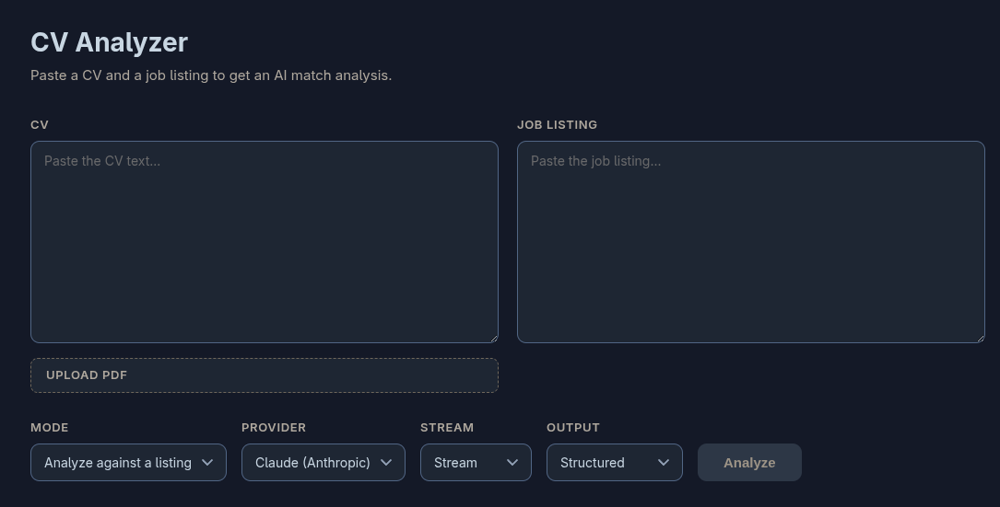

# CV Analyzer
 
An AI service that scores a CV against a job listing and returns a structured match analysis: a score, matched requirements, gaps in your CV, and concrete suggestions.
 
Built to explore the parts of LLM product engineering that are actually difficult to structure and execute: routing between providers, getting reliable structured output out of a model, and streaming a partially-formed response to a UI without it exposing the UI to unwanted visual artifacts.
 

 
## What it does
 
Paste a CV and a job listing (or upload the CV as a PDF), pick a provider and output mode, and receive your analysis. The interesting part is *how* the analysis is produced: the app supports four combinations across two providers, and each combination exercises a different technical path.
 
| | Not structured | Structured |
|---|---|---|
| **No stream** | Plain text analysis | Validated JSON: score, matched, missing, suggestions |
| **Stream** | Text streamed token-by-token | JSON streamed and assembled live in the UI |
 
## Architecture
 
Two services, plus a local model that stays on the host.
 
- **Backend:** FastAPI. Handles provider routing, structured-output enforcement, streaming, retrieval and PDF text extraction. Fully async: model calls are awaited on the event loop. Runs in a container.
- **Frontend:** React + TypeScript, built with Vite, served by nginx. Runs in a container.
- **Ollama:** the local model provider. Runs **on the host, not in a container**, because the model needs GPU access. The backend reaches it via `host.docker.internal`.

## Job matching with retrieval (RAG)

The analyze endpoints answer "how well does this CV fit *this* listing?" The `/match`
endpoint answers a different question: **"out of every listing we know about, which ones
should this CV go after?"** The user supplies only a CV, and retrieval picks the candidates.

### How it works

**Indexing (offline).** Each job listing is split into paragraph sized chunks. Every chunk
is embedded with `nomic-embed-text` running locally through Ollama, producing a 768
dimensional vector, and stored in Postgres with the pgvector extension. The parent listing
keeps its full text; chunks reference it by foreign key.

**Retrieval (per request).** The incoming CV is embedded with the same model, then compared
against the stored chunk vectors using cosine distance (`<=>`). Results are deduplicated by
parent listing with `DISTINCT ON`, so one posting cannot occupy several slots in the
shortlist, and the parent's full text is returned rather than the matching fragment.

**Generation.** Each retrieved listing goes through the existing structured analysis path,
concurrently via `asyncio.gather` (see "Async all the way down" for why that only became
true concurrency later). The response is a ranked list: company, title, cosine
distance, and the same `StructuredAnalysis` (score, matched, missing, suggestions) the
single listing endpoint produces.

The division of labour is the point of RAG: vector search is cheap and narrows a corpus to a
handful of candidates, and the expensive model call runs only on what survived.

### Chunking, and why

The first version embedded each listing as a single vector. It did not work. Querying a
corpus of six postings with *"building applications that use large language models"*
returned everything within 0.018 of everything else, with a scientific computing role
ranked second:

```
0.4288  Playtech            AI Engineer
0.4347  ICT Strypes         Python Software Engineer, ASML
0.4388  KBC Global Services Python Developer, M365 Integration
0.4424  Fastmarkets         AI Engineer
0.4464  Trading 212         DevOps Engineer
```

A job posting is not about one thing. Averaging responsibilities, requirements, benefits and
company boilerplate into a single vector produces "a job posting about software," which
every posting resembles. The distinguishing content is real but it is diluted by the shared
generic mass around it.

Chunking by paragraph fixed it. The requirements section of each listing becomes its own
vector, dense with the vocabulary that actually distinguishes it:

```
0.3596  Playtech            AI Engineer
0.4092  Fastmarkets         AI Engineer
0.4135  KBC Global Services Python Developer, M365 Integration
0.4226  ICT Strypes         Python Software Engineer, ASML
0.4518  Trading 212         DevOps Engineer
```

The three AI roles now take the top three, and the spread widened from 0.018 to 0.09.

The tradeoff is the usual one: chunks too large and retrieval is imprecise, chunks too small
and a requirement gets separated from the context that gives it meaning. Splitting on
paragraph boundaries respects the structure the documents already have, which beats fixed
character counts on this corpus.

### Verifying retrieval

The seed corpus is deliberately mixed: AI and Python roles, one general software role, one
scientific computing role, one infrastructure role. That variety is what makes the behaviour
testable rather than merely plausible, since cosine distance always returns *something*.

Two queries that share almost no vocabulary with their target still resolve cleanly:

| Query | Top result | Distance | Gap to second |
|---|---|---|---|
| debugging memory issues in C and C++ with low level tools | ICT Strypes (ASML) | 0.454 | decisive over the AI roles |
| keeping infrastructure running, incidents and monitoring | Trading 212 (DevOps) | 0.322 | 0.14 |

Neither query contains "Valgrind", "GDB", "Terraform" or "Kubernetes". Keyword search would
have missed both.

### Schema

```sql
CREATE EXTENSION IF NOT EXISTS vector;

CREATE TABLE listings (
    id      SERIAL PRIMARY KEY,
    company TEXT,
    title   TEXT,
    text    TEXT NOT NULL,
    UNIQUE (company, title)
);

CREATE TABLE chunks (
    id           SERIAL PRIMARY KEY,
    listing_id   INTEGER REFERENCES listings(id) ON DELETE CASCADE,
    chunk_index  INTEGER,
    text         TEXT NOT NULL,
    embedding    vector(768)
);
```

Re-seeding upserts listings on `(company, title)` and replaces their chunks wholesale.
Chunks are derived data whose boundaries shift when the chunking strategy changes, so
matching old chunks to new ones by index would be meaningless.

### Running it

```bash
docker compose up -d db        # Postgres with pgvector
ollama pull nomic-embed-text   # embedding model, runs locally
python seed.py                 # index the corpus
docker compose up --build backend frontend
```

Then choose **Find matching jobs**, paste a CV, and submit.

### Known limits

Embeddings are model specific: vectors from different embedding models are not comparable,
so changing the model means re-indexing the whole corpus. Retrieval has no distance
threshold, so an unrelated CV still returns the nearest listings rather than an empty
result. And retrieval quality caps generation quality, since the model can only reason over
the passages it is given.

### Provider routing
 
A single `provider` field on the request switches the backend between two model backends:
 
- **Anthropic:** via the official SDK's async client (`AsyncAnthropic`).
- **Ollama:** a locally hosted model via its HTTP API.

The two providers have different failure modes, so the backend keeps an explicit error taxonomy rather than collapsing everything into a 500:
 
- `400`: bad client input (missing CV or job listing).
- `502`: the model returned output that couldn't be parsed or validated.
- `503`: a dependency is unreachable: the local provider (Ollama), the database, or the embedding service.

This means a bad prompt, a malformed model response, and a dead provider are never confused with one another, which matters when you're debugging why a call failed.
 
### Async all the way down

Model calls are I/O: the backend spends most of each request waiting for Anthropic or Ollama. FastAPI runs every request on one event loop, so anything that waits without `await` freezes all of them.

- **The bug.** The first version wrapped the synchronous Anthropic client in `async def`. It looked asynchronous but wasn't: each call held the event loop, so `asyncio.gather` in `/match` ran the five analyses one after another. **42 s.**
- **The workaround.** `asyncio.to_thread` moved each call to a worker thread, freeing the loop. **16 s**, timed by hand.
- **The fix.** The provider now uses `AsyncAnthropic`. Calls are `return await client.messages.create(...)`, streams use `async with` and `async for`, and `analyze_one` awaits the provider directly, with no thread per call. **About 14 s** on Anthropic. The gain over the workaround is small, as expected: threads had already made the calls concurrent, so the request now takes about as long as its slowest analysis. What async adds is that no thread is spent per waiting call.
- **Ollama: about 18 s.** A local model serves requests largely one at a time (Ollama's `OLLAMA_NUM_PARALLEL`), so concurrency in the backend can't make the model itself faster.
- **What is still sync.** Retrieval uses a synchronous database driver, so `/match` runs `search()` through `asyncio.to_thread` to keep the loop free.

**Tests** use FastAPI's `TestClient`, which runs the event loop itself, so the test functions stay synchronous. What changed is the fakes: every fake for an awaited function is now async (a small `returns(value)` helper builds them, and error fakes are `async def` functions that raise), and the stream fakes are async generators. The error-mapping tests still prove the 502/503 taxonomy, because a failure now surfaces at the `await` inside `translate_provider_errors()`, exactly where the real client fails. A `/match` test fakes both boundaries (`search` as a plain function, `analyze_one` as an async one that echoes its posting text into the result) and checks that each posting comes back paired with its own analysis, in order.

### Structured output
 
Getting a model to reliably return JSON that matches a schema is done differently per provider, but both are driven by a **single Pydantic model** so there's one source of truth:
 
- **Anthropic:** forced tool use. The model is given a tool whose input schema *is* the Pydantic schema, and is required to call it, so the response is shaped by the schema rather than hoping the prose contains valid JSON.
- **Ollama:** JSON-schema-constrained generation. The same Pydantic schema is passed as a format constraint, so the model's output is restricted to valid instances.

In both cases the response is **re-validated server-side against the same Pydantic model** before it reaches the client. The model's output is never trusted as-is.
 
### Streaming and partial-JSON assembly
 
Both providers stream. Plain-text streaming is simple: tokens arrive, they're appended. Structured streaming is the harder problem: the JSON is incomplete on every chunk until the very last one, so it can't just be `JSON.parse`d as it arrives.
 
The frontend handles this by tracking bracket/quote depth as bytes stream in, closing any open structures to form a *valid* partial object, and parsing that, so the UI can render the score and matched requirements as they populate, mid-stream, rather than waiting for the whole response.

On the backend, both Anthropic streams are async generators (`async with client.messages.stream(...)` and `async for` over the events), which `StreamingResponse` consumes directly.
 
> **Note on the parser:** the current approach is a hand-written depth tracker, which works but is all-or-nothing per chunk and has edge cases around escaped characters inside strings. The cleaner solution is NDJSON: have the backend emit one complete JSON object per line, which sidesteps partial-parsing entirely. That's the planned next step; the current version is kept because building it surfaced *why* NDJSON is the right answer.
 
## Running it
 
### With Docker (recommended)
 
Ollama must be running on your host first (it stays outside Docker for GPU access):
 
```bash
ollama serve
ollama pull <your-model>
```
 
Then:
 
```bash
git clone <repo-url>
cd cv-analyzer
cp .env.example .env      # add your Anthropic API key
docker compose up --build
```
 
- Frontend: http://localhost:3000
- Backend API + docs: http://localhost:8000/docs
### Locally, without Docker
 
Backend:
 
```bash
cd backend
pip install -r requirements.txt
uvicorn main:app --reload
```
 
Frontend:
 
```bash
cd frontend
npm install
npm run dev
```
 
The Anthropic-only path works with just an API key; the Ollama path needs Ollama running locally.
 
## Configuration
 
| Variable | Where | Purpose |
|---|---|---|
| `ANTHROPIC_API_KEY` | `.env` | Anthropic API access (same value everywhere). |
| `CORS_ORIGINS` | `.env` | Comma-separated origins allowed to call the API. |
| `APP_PORT` | `.env` | Host port for the backend. |
| `OLLAMA_URL` | `docker-compose.yaml` | Set to `host.docker.internal` in Docker; native runs fall back to `localhost` via a code default. |
 
`OLLAMA_URL` lives in compose rather than `.env` on purpose: it needs a *different* value in Docker (`host.docker.internal`) than when run natively (`localhost`), so the Docker-specific value stays in the Docker-specific file, and native runs use the code default.
 
Copy `.env.example` to `.env` and fill in your own values. `.env` is gitignored and never committed.
 
## Tech stack
 
**Backend:** Python, FastAPI, Pydantic, pypdf, pytest
**Frontend:** React, TypeScript, Vite, nginx
**Infra:** Docker (multi-stage frontend build), GitHub Actions CI
**Models:** Anthropic API, Ollama
 
## Roadmap
 
- NDJSON streaming to replace the hand-written partial-JSON parser
- Side-by-side comparison of both providers on the same input
- Rate limiting and a spend cap, as prerequisites for a public deployment
- An async database driver for retrieval (today `search()` runs via `asyncio.to_thread`)
- One shared `httpx.AsyncClient` for Ollama instead of one per call
- Map Anthropic connection errors to 503 (they currently surface as 502, because the whole `anthropic.APIError` family is caught)
- A test for `/match` itself