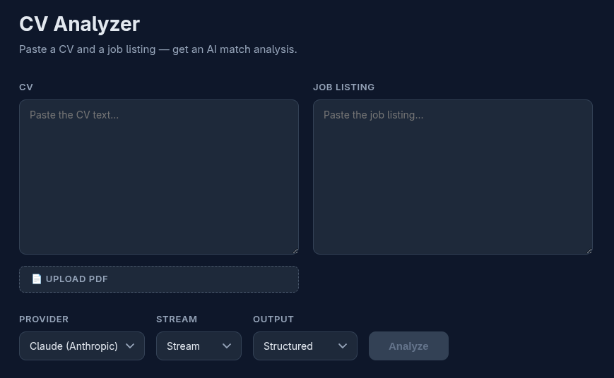

# CV Analyzer
 
An AI service that scores a CV against a job listing and returns a structured match analysis - a score, matched requirements, gaps in your CV, and concrete suggestions.
 
Built to explore the parts of LLM product engineering that are actually difficult to structure and execute: routing between providers, getting reliable structured output out of a model, and streaming a partially-formed response to a UI without it exposing the UI to unwanted visual artifacts.
 

 
## What it does
 
Paste a CV and a job listing (or upload the CV as a PDF), pick a provider and output mode, and receive your analysis. The interesting part is *how* the analysis is produced - the app supports four combinations across two providers, and each combination exercises a different technical path.
 
| | Not structured | Structured |
|---|---|---|
| **No stream** | Plain text analysis | Validated JSON: score, matched, missing, suggestions |
| **Stream** | Text streamed token-by-token | JSON streamed and assembled live in the UI |
 
## Architecture
 
Two services, plus a local model that stays on the host.
 
- **Backend** — FastAPI. Handles provider routing, structured-output enforcement, streaming, and PDF text extraction. Runs in a container.
- **Frontend** — React + TypeScript, built with Vite, served by nginx. Runs in a container.
- **Ollama** — the local model provider. Runs **on the host, not in a container**, because the model needs GPU access. The backend reaches it via `host.docker.internal`.
### Provider routing
 
A single `provider` field on the request switches the backend between two model backends:
 
- **Anthropic** — via the official SDK.
- **Ollama** — a locally hosted model via its HTTP API.
The two providers have different failure modes, so the backend keeps an explicit error taxonomy rather than collapsing everything into a 500:
 
- `400` — bad client input (missing CV or job listing).
- `502` — the model returned output that couldn't be parsed or validated.
- `503` — the local provider (Ollama) is unreachable.
This means a bad prompt, a malformed model response, and a dead provider are never confused with one another — which matters when you're debugging why a call failed.
 
### Structured output
 
Getting a model to reliably return JSON that matches a schema is done differently per provider, but both are driven by a **single Pydantic model** so there's one source of truth:
 
- **Anthropic** — forced tool use. The model is given a tool whose input schema *is* the Pydantic schema, and is required to call it, so the response is shaped by the schema rather than hoping the prose contains valid JSON.
- **Ollama** — JSON-schema-constrained generation. The same Pydantic schema is passed as a format constraint, so the model's output is restricted to valid instances.
In both cases the response is **re-validated server-side against the same Pydantic model** before it reaches the client. The model's output is never trusted as-is.
 
### Streaming and partial-JSON assembly
 
Both providers stream. Plain-text streaming is straightforward — tokens arrive, they're appended. Structured streaming is the harder problem: the JSON is incomplete on every chunk until the very last one, so it can't just be `JSON.parse`d as it arrives.
 
The frontend handles this by tracking bracket/quote depth as bytes stream in, closing any open structures to form a *valid* partial object, and parsing that — so the UI can render the score and matched requirements as they populate, mid-stream, rather than waiting for the whole response.
 
> **Note on the parser:** the current approach is a hand-written depth tracker, which works but is all-or-nothing per chunk and has edge cases around escaped characters inside strings. The cleaner solution is NDJSON — have the backend emit one complete JSON object per line — which sidesteps partial-parsing entirely. That's the planned next step; the current version is kept because building it surfaced *why* NDJSON is the right answer.
 
## Running it
 
### With Docker (recommended)
 
Ollama must be running on your host first (it stays outside Docker for GPU access):
 
```bash
ollama serve
ollama pull <your-model>
```
 
Then:
 
```bash
git clone <repo-url>
cd cv-analyzer
cp .env.example .env      # add your Anthropic API key
docker compose up --build
```
 
- Frontend: http://localhost:3000
- Backend API + docs: http://localhost:8000/docs
### Locally, without Docker
 
Backend:
 
```bash
cd backend
pip install -r requirements.txt
uvicorn main:app --reload
```
 
Frontend:
 
```bash
cd frontend
npm install
npm run dev
```
 
The Anthropic-only path works with just an API key; the Ollama path needs Ollama running locally.
 
## Configuration
 
| Variable | Where | Purpose |
|---|---|---|
| `ANTHROPIC_API_KEY` | `.env` | Anthropic API access (same value everywhere). |
| `CORS_ORIGINS` | `.env` | Comma-separated origins allowed to call the API. |
| `APP_PORT` | `.env` | Host port for the backend. |
| `OLLAMA_URL` | `docker-compose.yaml` | Set to `host.docker.internal` in Docker; native runs fall back to `localhost` via a code default. |
 
`OLLAMA_URL` lives in compose rather than `.env` on purpose: it needs a *different* value in Docker (`host.docker.internal`) than when run natively (`localhost`), so the Docker-specific value stays in the Docker-specific file, and native runs use the code default.
 
Copy `.env.example` to `.env` and fill in your own values. `.env` is gitignored and never committed.
 
## Tech stack
 
**Backend:** Python, FastAPI, Pydantic, pypdf, pytest
**Frontend:** React, TypeScript, Vite, nginx
**Infra:** Docker (multi-stage frontend build), GitHub Actions CI
**Models:** Anthropic API, Ollama
 
## Roadmap
 
- NDJSON streaming to replace the hand-written partial-JSON parser
- Side-by-side comparison of both providers on the same input
- Rate limiting and a spend cap, as prerequisites for a public deployment
- Async Anthropic client